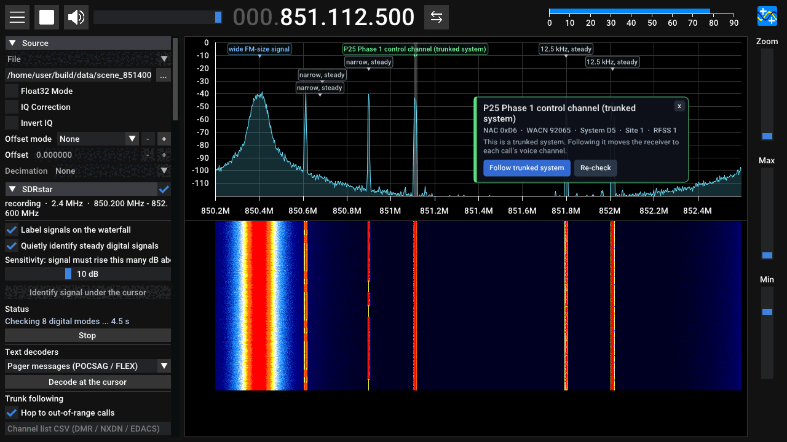
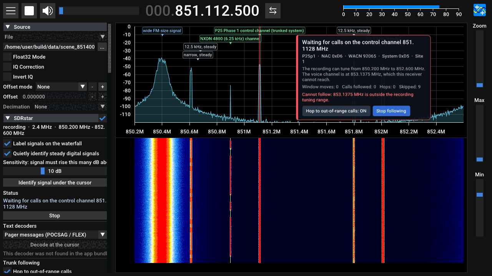
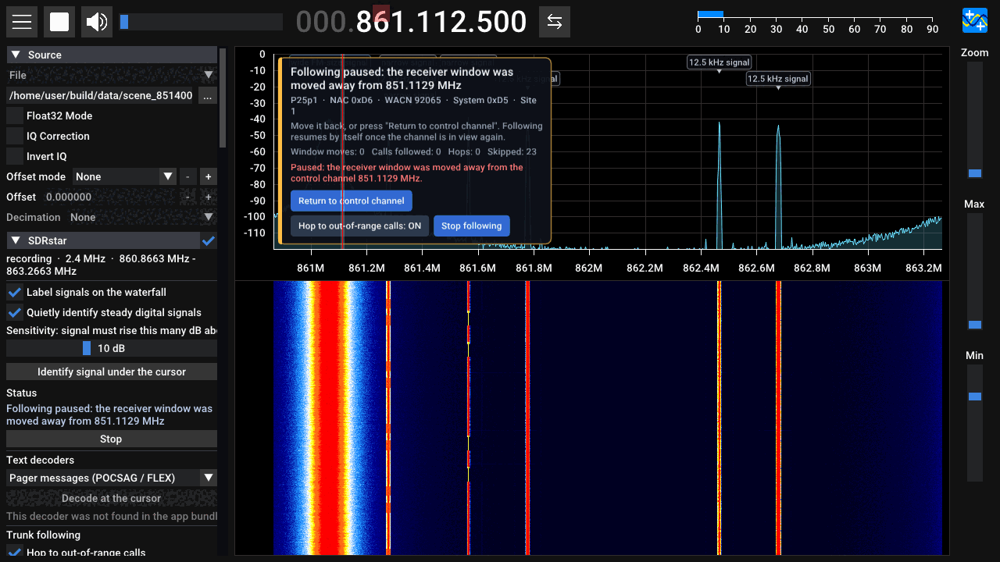
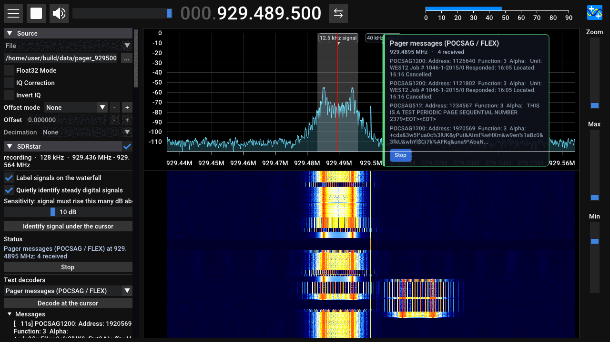
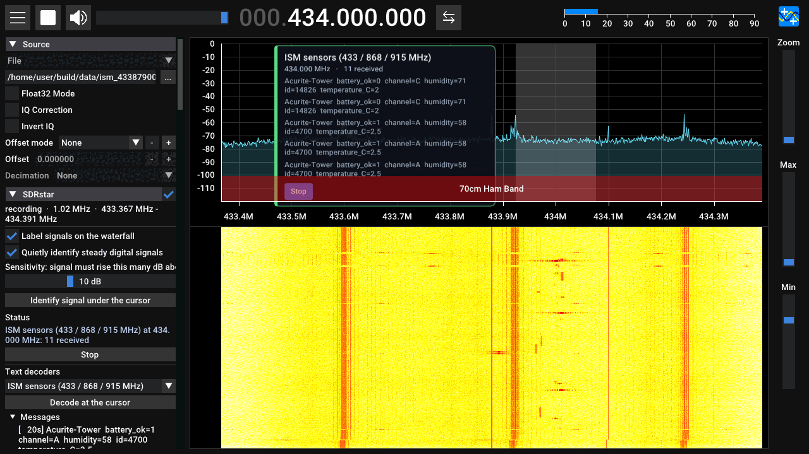
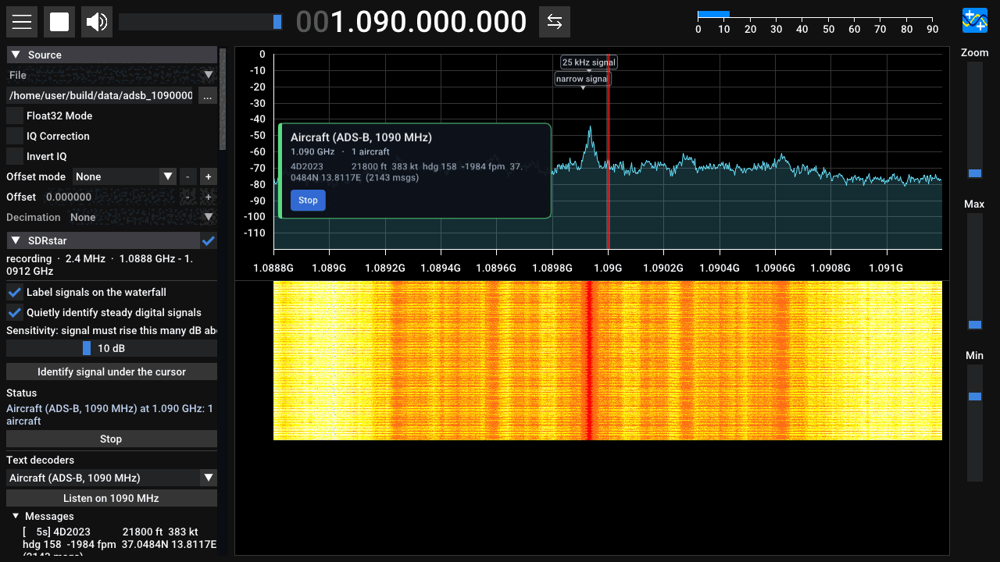

# SDRstar

**SDR++, but smart.** A double-click Mac app for the RTL-SDR (built around the RTL-SDR Blog V4) that keeps the SDR++
waterfall you already like, and adds a layer that labels what is on the air, tells you when something is digital,
decodes it, and follows trunked radio systems from the control channel to the talking channels.

> **Status, honestly.** Everything that can be tested without a radio has been: the logic, the decoders on real
> recordings, the whole GUI under a virtual display, the trunk follower on real recorded P25 traffic. What has **not**
> been done by anyone yet is running the finished `.app` on a real Mac with a real RTL-SDR plugged in (the build
> environment has neither; GitHub's Mac machines build the app and check that it loads and starts, but have no radio
> and no display). Read [docs/TESTING.md](docs/TESTING.md) for exactly what was and was not verified.

## What you get

* **The SDR++ interface.** Waterfall, drag the cursor (VFO) around, zoom, bookmarks, recorder, WFM / NFM / AM / SSB /
  CW demodulators, audio device selection: all of SDR++ 1.3.0 is still there.
* **Signal labels on the waterfall.** Signals whose digital protocol was really decoded are labelled ("P25 Phase 1 control
  channel", "DMR channel" ...) and keep that label until they really change; one setting labels every signal found instead
  with a short fact-only description ("12.5 kHz, steady", "FM broadcast"), plus what that band is normally used for.
* **A card next to your cursor.** Rest the cursor on a signal and a small card tells you what it is and offers the
  obvious next step: *Listen as FM*, *Identify digital signal*, *Read pager messages*, *Follow trunked system* ...
* **Automatic digital identification.** Steady narrow signals are quietly tested against the digital modes that
  could live there (P25 Phase 1 and 2, DMR, NXDN, dPMR, D-STAR, YSF, M17, ProVoice, EDACS). A protocol is only
  *claimed* after enough error-checked data has really been decoded, so you do not get confident wrong guesses.
* **Trunk following.** Drag onto a control channel: the card says it is a trunked system (with system ID, NAC,
  site ...) and offers **Follow trunked system**. SDRstar then moves to each call's voice channel and plays the voice, and
  your cursor goes with it so it is always on what you hear; clicking elsewhere stops.
* **It uses the whole tuner range and says what it is doing.** The listening window (about 2 MHz wide) is moved
  automatically to hold what you need, anywhere from 0.5 MHz to 1.766 GHz. When something cannot be done, it says
  why in plain English ("The voice channel is at 853.1375 MHz, which this receiver cannot reach" / "5.2 MHz from the
  control channel; this receiver can only see 1.92 MHz at once").
* **Text decoders.** Pager messages (POCSAG / FLEX), APRS, weather alerts (EAS), 433 / 868 / 915 MHz sensors
  (weather stations, tyre-pressure sensors, utility meters ... 200+ device types) and **aircraft (ADS-B, 1090 MHz)** with
  callsign, altitude, speed, heading, climb rate and position.

## What it looks like

These are real screenshots of the finished app, taken on a Linux test machine with a virtual display while it played
recorded radio signals (no radio hardware involved). The waterfall colour levels are SDR++'s defaults, untuned.

| | |
| --- | --- |
|  |  |
| **Identified automatically.** The card says what the signal is (P25 Phase 1 control channel, system details) and offers **Follow trunked system**. | **Following.** Status in plain words. Here the recording cannot retune, so the card says exactly why a call cannot be followed. |
|  |  |
| **You moved the radio away?** Following pauses, says so, and offers **Return to control channel**. | **Pager messages**, decoded from a real POCSAG recording. |
|  |  |
| **Sensors** (weather stations and the like): repeated copies of a message are shown once with a count. | **Aircraft (ADS-B)**: callsign, altitude, speed, heading, climb rate, position. |

## Install (no commands)

Short version: download `SDRstar-AppleSilicon.dmg` (M1/M2/M3/M4 Macs) or `SDRstar-Intel.dmg`, open it, drag SDRstar
to **Applications**, double-click it. The first launch needs one extra confirmation because the app is not signed
with a paid Apple Developer ID.

Full step by step, including how to get the DMG from GitHub: **[INSTALL-MAC.md](INSTALL-MAC.md)**.

## Using it

**[docs/USER_GUIDE.md](docs/USER_GUIDE.md)** walks through it: the card, following a trunked system, what the
messages mean, the settings, and the channel-list files DMR / NXDN / EDACS systems need.

## Limits you should know about

* **One RTL-SDR is one tuner.** It sees about 2.4 MHz at once (about 1.92 MHz is usable). Calls on far-apart
  frequencies cannot be heard at the same time, and while the receiver hops to a far-away voice channel it cannot
  hear the control channel. SDRstar tells you when this happens.
* **Encrypted calls are not decoded.** They are reported as encrypted.
* **DMR, NXDN and EDACS trunking need a channel list** (a small CSV, format in the user guide). P25 systems announce
  their own channel plan, so they need nothing.
* **Weak spots measured on the test recordings:** NXDN96 and dPMR decode only weakly through the audio path SDRstar
  uses, so they may be identified less reliably than the others. TETRA and AIS are not decoded. ADS-B needs the 2.4 MS/s sample rate (the default).
* **Not yet tried on real hardware** (see status above). If something about the live radio path misbehaves, the
  [troubleshooting section](INSTALL-MAC.md#troubleshooting) says what to check.

## Safety

The RTL-SDR can only receive; SDRstar has no transmit code. The bias tee is always off at launch and needs a
deliberate tick every time. Decoders run as separate helper processes, each in its own working folder, built so they cannot
touch the USB radio. [docs/SAFETY.md](docs/SAFETY.md) lists every protection, how each was checked, and the physical precautions
software cannot provide.

## How it is built

SDRstar = SDR++ 1.3.0 (pinned) + a small set of patches + one added module (`sdrstar_smart`) + a plain C++ library
(`sdrstar_core`) with the logic + helper programs (DSD-neo, multimon-ng, rtl_433). Nothing is forked.
Design reasons, data flow and limits: [docs/ARCHITECTURE.md](docs/ARCHITECTURE.md). Building it yourself:
[docs/MAC_BUILD.md](docs/MAC_BUILD.md).

## Licences and credits

GPL-3.0-or-later (SDRstar is a derivative of SDR++). It stands on SDR++ by Alexandre Rouma, DSD-neo / DSD-FME / DSD,
mbelib, multimon-ng, rtl_433, librtlsdr and others; see [THIRD_PARTY.md](THIRD_PARTY.md) for each project, its licence
and the exact version used, and for the note about vocoder patents. Receiving radio is legal in most places but
what you may listen to and do with it differs by country; you are responsible for following your local rules.
